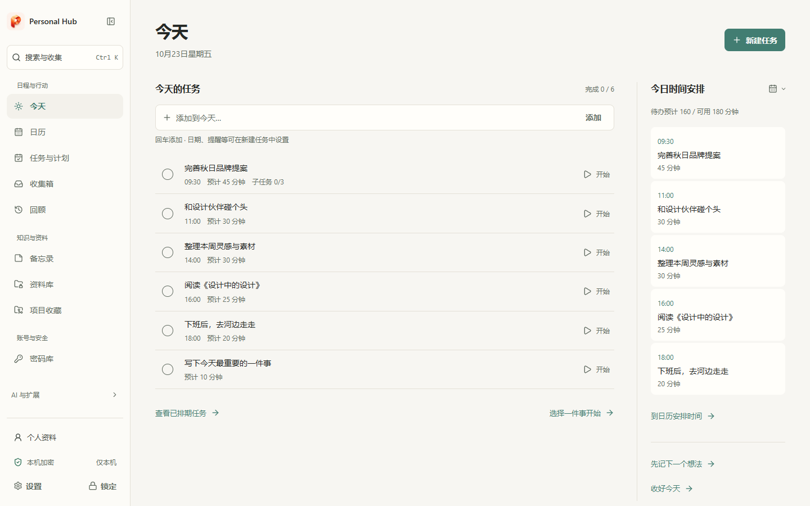
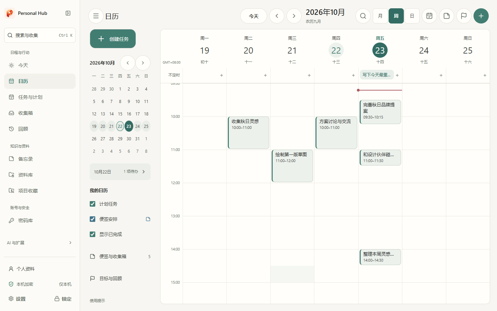
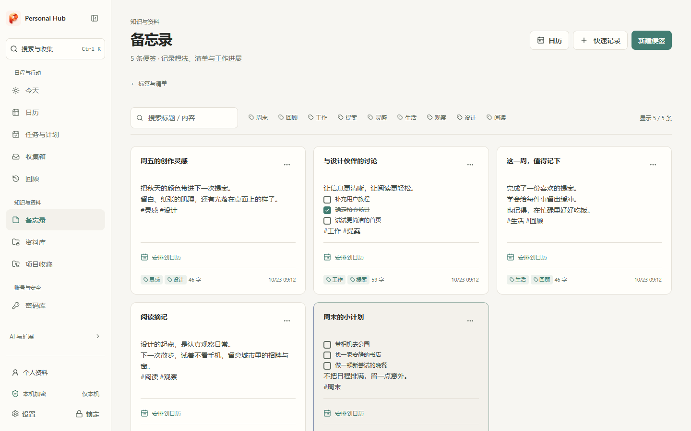
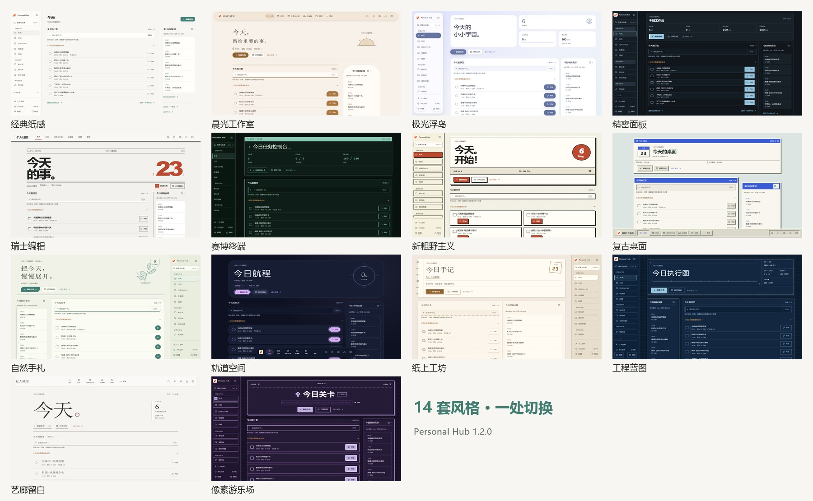
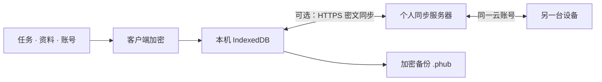

<div align="center">

# Personal Hub

**让记录接上行动。**

一个本地优先的个人工作台，将任务、日程、灵感、资料与账号密码放在一起。

[](https://github.com/ZDB932-ai/personal-hub/actions/workflows/ci.yml)
[](https://github.com/ZDB932-ai/personal-hub/releases/tag/v1.2.0)
[](LICENSE)

[打开网页版](https://111.91.19.235) · [下载安装](https://github.com/ZDB932-ai/personal-hub/releases/tag/v1.2.0) · [快速开始](#快速开始) · [更新记录](CHANGELOG.md) · [开发指南](docs/DEVELOPMENT.md)

</div>



从一个随手记下的想法，到安排时间、找到资料、完成任务，Personal Hub 将这些步骤连接起来。Windows、Android 和 Web 使用相同的内容结构；既可以只在本机使用，也可以通过云账号继续另一台设备上的工作。

**1.2.0 集成预览版**汇总了云账号、Android 后台同步、Windows 桌面清单，以及新的界面与设置系统。升级已有设备前，请在「设置 → 备份与迁移」导出加密备份。[查看本版变化与验证范围](docs/RELEASE-1.2.0.md)。

## 下载与体验

| 平台 | 入口 | 说明 |
| --- | --- | --- |
| Web | [直接打开](https://111.91.19.235) | HTTPS 网页，无需安装；本地数据按站点地址隔离 |
| Windows x64 | [安装程序](https://github.com/ZDB932-ai/personal-hub/releases/download/v1.2.0/Personal-Hub-1.2.0-Windows-x64-setup.exe) | 托盘、桌面清单、桌面伙伴；需要 WebView2 |
| Android | [正式签名 APK](https://github.com/ZDB932-ai/personal-hub/releases/download/v1.2.0/Personal-Hub-1.2.0-Android.apk) | 系统提醒、生物识别、可选后台密文同步 |
| 自行托管 | [静态 Web 包](https://github.com/ZDB932-ai/personal-hub/releases/download/v1.2.0/Personal-Hub-1.2.0-Web.zip) | 部署到 HTTPS 站点根目录或 localhost |

[所有发布文件](https://github.com/ZDB932-ai/personal-hub/releases/tag/v1.2.0) · [SHA-256 校验文件](https://github.com/ZDB932-ai/personal-hub/releases/download/v1.2.0/SHA256SUMS.txt)

Android 正式包名为 `com.zdb.personalhub`，1.2.0 的 versionCode 为 16，沿用现有签名。更新时使用覆盖安装，避免先卸载。最低 Android 版本配置为 7.0，真机验证主要在 Android 16。Windows 安装程序尚无 Authenticode 签名；macOS、Linux、iOS 暂无原生安装包。

在线站点是小规模个人部署，云账号数量受服务器配额限制，不是无限容量的公共云服务。可以选择仅在本机使用，或[自行部署同步服务](docs/SYNC-SERVER.md)。

## 从记录到行动

| 你想做什么 | Personal Hub 提供什么 |
| --- | --- |
| 理清今天 | 今日重点、快速添加、子任务、预计用时、日程时间轴 |
| 安排接下来 | 日历、周计划、长期目标、每日精力与可用时间 |
| 留住想法 | 收集箱、彩色便签、标签与清单，关联或转为任务 |
| 找到需要的资料 | 加密资料库，图片、PDF、文档、表格、音视频预览，按需下载附件 |
| 管理账号 | 密码库、密码生成、动态验证码、复制后自动隐藏 |
| 接上已有工具 | GitHub 项目收藏、Agent 资源库、可配置的 AI 工作台 |
| 保持进展 | 全局搜索、专注、回顾、本机回收站与修改历史 |

AI 工作台需要自行连接兼容服务；安装应用不会自动获得模型服务或 API 额度。项目以个人使用为主，暂无团队协作与企业权限体系。

<table>
<tr><td width="50%"></td><td width="50%"></td></tr>
<tr><td align="center">让任务进入具体的时间</td><td align="center">让灵感有一个安放的地方</td></tr>
</table>

## 14 套风格，一个熟悉的工作台

在「设置 → 外观 → 界面风格」切换设计。风格会改变导航、任务、日历、表单和控件的呈现；内容仍在原来的位置。可单独调整浅色 / 深色 / 跟随系统、强调色与背景，也可以应用推荐搭配。



经典纸感、晨光工作室、极光浮岛、精密面板，以及瑞士编辑、赛博终端、新粗野主义、复古桌面、自然手札、轨道空间、纸上工坊、工程蓝图、艺廊留白、像素游乐场。

设置页按「个性化」「账户与数据」「帮助」组织，并支持搜索直达相关选项。桌面使用双栏布局，手机按分类进入详情，适配触控、窄屏和软键盘。

## 跨设备使用

| 能力 | Web | Windows | Android |
| --- | :---: | :---: | :---: |
| 任务、资料、密码与外观 | ✓ | ✓ | ✓ |
| 云账号与前台自动同步 | ✓ | ✓ | ✓ |
| 加密备份、设备迁移 | ✓ | ✓ | ✓ |
| 系统文件保存 | 浏览器下载 | 原生选择器 | 原生选择器 |
| 生物识别解锁 | — | — | ✓ |
| 关闭主窗口后托盘运行 | — | ✓ | — |
| 独立桌面清单 | — | ✓ | — |
| 桌面伙伴 | 预览 | ✓ | 预览 |
| 可选后台密文传输 | — | 主进程运行时 | ✓，受系统限制 |

Windows 桌面清单提供独立待办窗口、置顶、折叠、尺寸与位置保存；锁定后的显示范围由用户选择。Android 的「及时后台同步」使用前台服务与常驻通知，后台只传输密文，解锁后再校验并合并内容。系统省电、强行停止、断网和运行时限仍会影响及时性。[后台同步说明](docs/ANDROID-BACKGROUND-SYNC.md)

## 快速开始

1. **选择使用方式。** 跨设备使用可创建云账号，其他设备用同一账号登录；只在一台设备使用，可选择「仅在本机使用 / 旧版设备加入」。
2. **保存恢复方式。** 在「设置 → 账户与恢复」保存对应恢复密钥，并放在应用以外的安全位置。云恢复密钥与本机恢复密钥用途不同。
3. **安排第一件事。** 在「今天」添加任务，填写预计用时，必要时拆分子任务、关联资料或放进日历。
4. **打造自己的工作区。** 在「设置 → 外观」选风格；Windows 可继续配置桌面清单与桌面伙伴。
5. **建立备份习惯。** 从「备份与迁移」导出 `.phub`，重要更新前另存一份。

## 数据如何保存

业务数据和附件在客户端加密后保存。v3 账户使用随机数据密钥，密码通过 Argon2id 派生封装密钥，业务密文采用 AES-256-GCM；改密更新密钥封装，不重新生成业务密钥。



服务器保存加密记录、附件密文、账号认证校验信息及必要的协议元数据。锁定后清除内存中的主密钥与业务明文。此设计不等于经过第三方安全审计；具体实现与边界见 [安全说明](SECURITY.md)、[设备密钥](docs/DEVICE-KEYS.md) 和 [云账号](docs/CLOUD-ACCOUNT.md)。

**恢复密钥不能代替备份，云同步也不能代替独立备份。** 云恢复依赖服务器仍保留相应记录；本机恢复方式不会随普通备份、设备加入或云同步自动转移。没有有效密码或预设恢复方式时，无法承诺找回数据。

<details>
<summary>常见问题</summary>

**登录提示无法连接云服务？** 先确认网络和服务器地址能通过 HTTPS 访问。首次云登录需要联网；已经登录过的设备可以离线解锁。刚提交改密或恢复后遇到超时，请先用新密码登录确认结果，避免反复提交。

**网页版和桌面版为什么没有同一份本地数据？** 各端存储相互独立。用同一云账号登录完成同步，或通过备份 / 设备迁移加入；仅仅打开同一个项目不会自动共享本地数据库。

**关闭页面后还会同步吗？** Web 页面被关闭或挂起后不能保证运行。Windows 关闭到托盘时由仍在运行的主进程处理；Android 需要启用相关后台选项并允许系统权限。强行停止应用会中断运行。

**可以完全离线吗？** 本机账户的核心功能可离线使用；云账号首次登录和密码恢复需要联网。附件应提前下载。Web 静态包需要 HTTPS 或 localhost，不要直接双击 HTML，也不将当前网页描述为已验收的离线 PWA。

**如何校验安装包？** 在 PowerShell 中运行 `Get-FileHash 下载的文件 -Algorithm SHA256`，与同版本 `SHA256SUMS.txt` 对照。

</details>

## 开发与部署

需要 **Node.js 24.x**。前端使用 Vue 3、TypeScript、Vite 8、Tailwind CSS 4；Windows 使用 Tauri 2，Android 使用 Capacitor 8；同步服务使用 Node.js 与 SQLite。

```bash
git clone https://github.com/ZDB932-ai/personal-hub.git
cd personal-hub
npm ci
npm run dev
```

```bash
npm run test -- --maxWorkers=2
npm run sync:typecheck
npm run build
npm run preview -- --host 127.0.0.1 --port 4183
# 保持预览服务运行，在另一终端执行 npm run test:ui
```

构建 Windows：`npm run desktop:build`。构建 Android：`npm run build` → `npx cap sync android` → Gradle。完整工具链、签名与环境变量见 [开发指南](docs/DEVELOPMENT.md)。自部署同步服务请阅读 [服务部署](docs/SYNC-SERVER.md)，使用自己的服务器、TLS 与凭据。

| 文档 | 内容 |
| --- | --- |
| [1.2.0 发布记录](docs/RELEASE-1.2.0.md) | 并行更新整合、产物、验证边界 |
| [界面风格](docs/INTERFACE-GALLERY.md) | 风格设计与响应式行为 |
| [云账号与恢复](docs/CLOUD-PASSWORD-RECOVERY.md) | 改密、恢复密钥、其他设备重新登录 |
| [同步体验](docs/SYNC-EXPERIENCE.md) | 重连、离线、冲突与附件 |
| [Android 后台同步](docs/ANDROID-BACKGROUND-SYNC.md) | 原生传输设计与真机验证记录 |
| [桌面清单](docs/DESKTOP-TODO-PLAN.md) | 独立窗口、操作与锁定行为 |
| [贡献约定](CONTRIBUTING.md) | 问题反馈与开发协作 |

欢迎通过 [Issues](https://github.com/ZDB932-ai/personal-hub/issues) 提交可复现问题。请提供版本、平台与复现步骤，避免上传真实密码、令牌、恢复密钥或未脱敏的个人信息。安全问题按 [SECURITY.md](SECURITY.md) 处理。

项目原创代码采用 [MIT](LICENSE)。第三方依赖、角色与素材保留各自权利，具体来源与尚待确认的分发范围见 [素材与依赖清单](THIRD_PARTY_NOTICES.md)。本页截图均使用独立合成演示数据。
