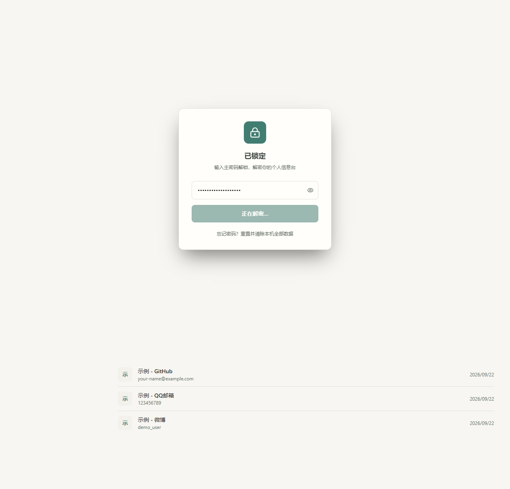
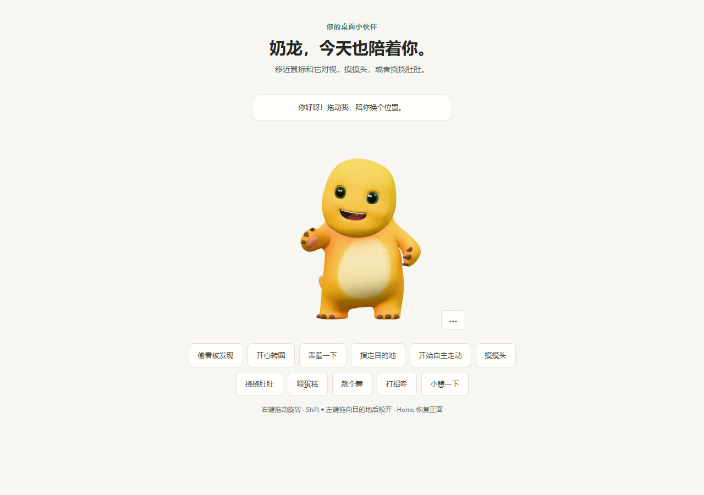

# Personal Hub · 个人信息管理台

本地优先的个人管理工具，将计划、备忘录、资料、密码与桌面宠物放在一起。核心功能无需服务器。支持 Web、Windows 桌面版和 Android。

当前准备版本：**1.1.1 预览版**。安装包尚待发布到目标仓库的 Releases，当前文档不代表已经公开发布。





## 功能

- **桌面宠物**：Windows 透明悬浮窗口、拖动和旋转、摸头喂食、挥手跳舞、小憩、自主走动、托盘后台陪伴及任务互动提醒。模型与八段动画随包提供，不需要联网下载。
- **每日计划**：今天、本周、待安排、重复任务、子任务、周与长期计划、精力及分钟容量排期。
- **备忘录与资料库**：标签、清单、转任务、任务来源关联；附件加密、图片/PDF/Word/表格/音视频预览。
- **密码库**：主密码保护、密码生成、收藏、TOTP 动态码；Android 可选指纹解锁。
- **全局搜索与恢复**：Ctrl/Cmd+K 搜索和收集、回收站、修改历史、包含附件的加密备份。
- **项目与 Agent**：GitHub 项目收藏、Agent 资源台账；AI 工作台为可选外部连接能力，需要自行安装配置 Agent/bridge。
- **外观**：明暗主题、色调、界面样式、内置或自定义壁纸。

## 桌面宠物怎么打开

Windows 版进入 **设置 → 玩偶 → 开启桌面玩偶**。默认关闭，可选择关闭主窗口到托盘后继续陪伴；从托盘菜单“退出”会同时退出宠物。

按住角色拖动，右键拖动旋转，Home 恢复正面；互动菜单可喂食、跳舞、打招呼、休息和自主走动。双击角色打开主页，找不到角色时在设置中“找回玩偶位置”。网页和 Android 可预览角色，不提供系统级悬浮窗。网页独立互动预览地址为 `/?pet=1`。

当前可编辑 Blender 工程位于 `assets/pet-models/tripo-fixed/nailong-expression-polish.blend`，运行模型位于 `public/pets/nailong-animated.glb`。历史建模脚本部分依赖未随源码提供的阶段输入，请以当前工程和 [宠物交接索引](docs/PET-HANDOFF.md) 为维护入口。

## 开发运行

使用 Node.js 24 与 npm。在项目目录执行：

```sh
npm ci
npm run dev
```

访问终端显示的本机地址。检查与生产构建：

```sh
npm run test -- --maxWorkers=2
npm run sync:typecheck
npm run build
npm run preview -- --host 127.0.0.1 --port 4183 --strictPort
```

另一个终端执行 `npm run test:ui`。默认使用已安装的 Edge；也可先 `npx playwright install chromium`，设置 `PHUB_BROWSER_CHANNEL=chromium`。Playwright 已作为固定版本开发依赖纳入锁文件。UI 验收使用独立合成数据，不读取已有个人保险库。

## 原生构建

Windows：安装 Rust/MSVC 构建工具和 WebView2，执行 `npm run desktop:build`。NSIS 输出在 `src-tauri/target/release/bundle/nsis/`，桌面宠物资源会一起打包。

Android：安装 Android SDK 36/build-tools 36.0.0、JDK 21，配置 `ANDROID_HOME`、`ANDROID_SDK_ROOT` 和 `JAVA_HOME`。若 Gradle 主运行 JDK 使用其他版本，可用 `PHUB_JDK21_HOME` 提供 JDK 21 工具链路径。

```sh
npm run build
npx cap sync android
cd android
./gradlew assembleDebug
```

Windows 使用 `gradlew.bat`。中文路径环境可创建本机英文路径目录联接，勿修改源码为固定个人路径。Debug 包为独立测试版，不覆盖正式版。Release 签名配置格式见 [构建与发布](docs/PREVIEW-RELEASE.md)，私钥和密码不得提交。

## 数据与备份

业务数据保存在本机 IndexedDB，使用 Argon2id 与 AES-GCM 加密；附件单独加密保存。主密钥只在解锁会话内使用；Android 开启指纹后，主密码由系统安全凭据存储保护。

首次使用后、升级前和重要修改后，请在 **设置 → 备份** 导出包含附件的 `.phub`，另存于独立位置。忘记主密码无法恢复加密数据；清除浏览器/应用数据会清除本机内容。导入备份为恢复内容，不是自动合并。备份中的旧密码仍适用于该旧备份。

## 预览版边界

- Android 已安排提醒在锁定后保留，通知不显示任务正文；最多安排最近 60 条，更多任务在下一次解锁或编辑后补排，后台递补未实现。系统权限、省电和后台限制会影响实际送达。
- Windows/Web 的任务与宠物提醒需要应用运行并保持解锁；锁定后暂停，解锁后补检查。当前不提供退出后的定时提醒。
- Windows 系统通知点击跳转尚未实现；可通过托盘或双击宠物打开主页。
- 删除资料后保留附件供恢复，清空历史不会自动释放附件空间。
- 正文搜索限当前解锁会话内的文本和含文字 PDF，没有 OCR/Office 全文索引。
- 宠物多显示器、不同缩放和长时间运行仍需扩大验收，部分动作可能有滑步或局部形变。
- Windows 安装包未配置发布者数字签名。最新验证情况以 [预览发布记录](docs/PREVIEW-RELEASE.md) 为准。
- 可选同步需要自行配置服务，首版不附带托管服务。GitHub 仓库子路径网页部署还需要静态资源 base 适配。

## 文档与反馈

[发布说明](CHANGELOG.md) · [构建与发布](docs/PREVIEW-RELEASE.md) · [素材清单](THIRD_PARTY_NOTICES.md) · [安全说明](SECURITY.md) · [贡献说明](CONTRIBUTING.md)

普通问题请在目标仓库发布后提交 Issue，注明版本、系统、复现步骤，使用合成数据截图。不要上传密码、令牌、真实备份或设备加入文件。

本项目原创代码与文档采用 [MIT License](LICENSE)。按项目所有者要求，准备公开完整源码及随包运行资源，GitHub 上传由所有者自行完成。第三方依赖、角色、模型参考图等不因本项目 MIT 许可而被重新授权，具体范围见 [素材清单](THIRD_PARTY_NOTICES.md)。原生功能和桌面宠物均包含在本地候选包中。
