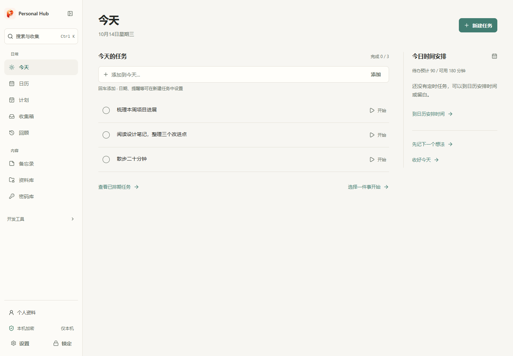
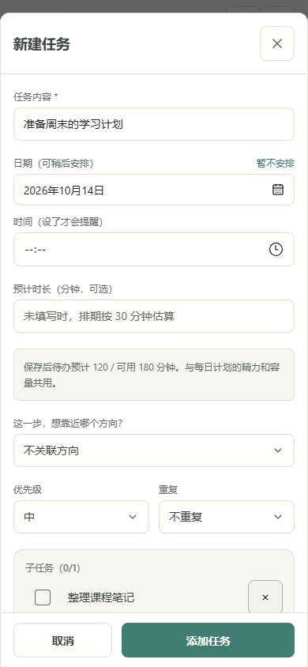
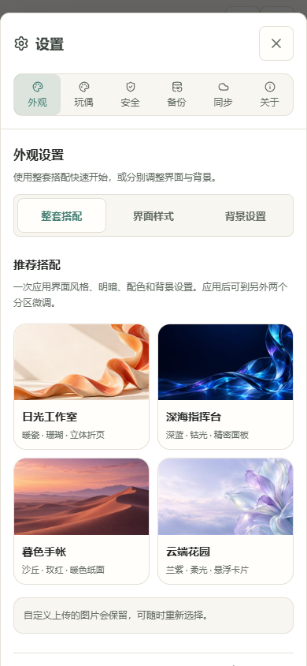

# Personal Hub · 个人工作台

**把随手记录的想法、今天要做的事和需要的资料，放在一个本地优先的工作台里。**

Personal Hub 面向个人使用，支持 **Windows、Android 和 Web**。从随手收集、安排任务，到关联资料、完成复盘，让记录能够接上行动。核心功能在设备本地运行，无需注册云端账号或部署服务器。

[下载安装](https://github.com/ZDB932-ai/personal-hub/releases/tag/v1.1.4) · [快速开始](#快速开始) · [功能](#功能) · [开发与构建](#开发与构建) · [更新记录](CHANGELOG.md)

> 当前版本：**1.1.4 预览版**。仓库目前为私有仓库，查看源码与下载安装包需要对应的 GitHub 访问权限。



## 用它做什么

- **先记下来**：想法、待办和临时信息放进收集箱，不必立即整理。
- **安排今天**：将记录转成任务，设置时间、预计用时和子任务，用日历查看安排。
- **带着资料开始**：把备忘录、文档或项目收藏关联到任务，减少来回寻找。
- **逐步推进目标**：用周计划、长期计划和每日精力设置，把目标拆成可执行的下一步。

此外，它还提供加密密码库、文件预览和可选的桌面宠物。适合希望把日常安排与个人资料集中管理的人；团队协作、公开分享和企业权限管理不在当前定位内。

## 下载安装

在 [v1.1.4 发布页](https://github.com/ZDB932-ai/personal-hub/releases/tag/v1.1.4) 的 **Assets** 中下载：

| 平台 | 文件 | 说明 |
| --- | --- | --- |
| Windows x64 | `Personal-Hub_1.1.4_windows-x64-setup.exe` | NSIS 安装程序，需要 WebView2 运行时 |
| Android | `Personal-Hub_1.1.4_android.apk` | 正式签名包，应用标识为 `com.zdb.personalhub` |
| Android 测试版 | `Personal-Hub_1.1.4_android-test.apk` | 独立应用标识 `com.zdb.personalhub.debug`，可与正式版并存 |
| Web | `Personal-Hub_1.1.4_web.zip` | 已构建的静态文件，解压后通过 Web 服务器访问 |
| 校验文件 | `SHA256SUMS.txt` | 下载文件的 SHA-256 校验值 |

Android 最低版本配置为 Android 7.0；实际设备验证范围见[发布记录](docs/RELEASE-1.1.4.md)。Windows 安装程序尚无代码签名，系统可能显示未知发布者提示。

**更新前请先在「设置 → 备份」导出 `.phub` 备份。** Android 请使用同一应用标识、同一签名的包覆盖安装，不要先卸载；正式版与测试版的数据各自独立。Web 的域名、协议或端口改变，也会切换到另一份本地存储。

Web 包可部署到 HTTPS 站点根目录，或在解压目录运行 `npx serve .` 后通过 `localhost` 访问。不要直接双击 `index.html`；加密能力需要 HTTPS 或 localhost 安全上下文。目前不提供公共在线演示站。

## 快速开始

1. 首次打开时创建本地账户、设置主密码，并把**完整恢复密钥**保存在应用之外。
2. 在「今天」添加一项任务；暂时不想安排的内容放进「收集」。
3. 用「日历」查看时间安排，在「资料库」或「备忘录」保存相关内容。
4. 在「设置 → 备份」导出加密备份，并定期更新备份文件。
5. 需要跨设备使用时，再配置可选的自托管同步服务。

桌面和网页端可用 `Ctrl / Cmd + K` 打开全局搜索与收集。手机端通过底部导航进入常用页面，其他功能集中在「更多」。

## 功能

| 模块 | 可以做什么 |
| --- | --- |
| 今天与计划 | 快捷输入、优先级、标签、子任务、重复任务、周计划、长期目标、每日精力与容量排期 |
| 日历与专注 | 查看任务时间、调整安排、开始专注、记录推进过程 |
| 收集与备忘录 | 随手收集、便签、清单、置顶、筛选，以及转为任务 |
| 资料库 | 加密保存附件；预览图片、PDF、Word、表格、文本、音视频；分类、搜索和批量管理 |
| 密码库 | 账号密码、随机密码生成、强度提示、TOTP 动态码；Android 可选生物识别解锁 |
| 查找与恢复 | 全局搜索、本机回收站、修改历史、加密备份和设备加入文件 |
| 可选同步 | 自托管服务、客户端加密、逐条同步、冲突对比、附件按需下载 |
| 项目与 Agent | GitHub 项目收藏、Agent 资源台账；AI 工作台需另行配置对应服务或 bridge |
| 外观与桌面 | 深浅主题、多种色调与壁纸；Windows 托盘、单实例、窗口位置记忆和桌面宠物 |

### 手机端

手机布局围绕单手操作优化：任务编辑保留可见的保存按钮，设置分区固定在顶部，资料库将搜索、排序和分类分层展示。

<p>
  
  
</p>

以上截图使用演示账户与虚构内容，不包含真实个人数据。

### 桌面宠物

Windows 版内置透明悬浮宠物，支持动画、互动与走动；双击可打开主窗口。在设置中开启，默认关闭。退出整个应用请使用托盘的退出操作。Web 和 Android 提供预览，不提供系统级悬浮桌宠。

模型来源、授权边界与维护说明见 [第三方声明](THIRD_PARTY_NOTICES.md) 和 [桌宠交接文档](docs/PET-HANDOFF.md)。

## 数据、恢复与同步

- **本地优先**：业务数据保存在设备本地；附件也保存在本机，需要同步时才连接自托管服务。
- **加密存储**：使用 Argon2id 和 AES-256-GCM。新账户采用 v3 随机数据密钥与密码封装，解锁后的密钥仅保留在内存。
- **密码恢复**：已预设恢复密钥的设备可以重设主密码。旧账户可在安全设置中主动升级；未设置恢复方式且遗失密码时，无法解密数据。
- **恢复密钥不等于备份**：恢复信息是设备本地配置，不随普通 `.phub` 备份、设备加入或云同步转移。它不能找回已删除的数据库或附件；导入历史备份仍需保留对应密码。
- **同步可选**：当前逐条同步服务需自行部署。服务端存储密文，客户端解锁后可按已保存配置重连。旧版 PocketBase 整库同步仅保留兼容路径。

清除浏览器站点数据或卸载应用可能丢失本地内容，请先备份。项目尚未经过独立安全审计；密码库的安全设计和测试范围可查阅下列技术文档。

[本地账户与恢复](docs/LOCAL-ACCOUNT.md) · [设备密钥](docs/DEVICE-KEYS.md) · [备份与本地存储](docs/LOCAL-STORAGE.md) · [同步部署](docs/SYNC-SERVER.md) · [同步体验](docs/SYNC-EXPERIENCE.md)

## 当前边界

- 这是持续迭代中的预览版。真机验证集中在当前 Windows 环境和一台 Android 16 设备，尚未覆盖全部系统版本、字体缩放、后台策略及正式包升级场景。
- Android 使用系统提醒，并安排最近 60 条；是否准时触发仍受系统权限与省电策略影响。Windows/Web 依赖应用运行且解锁时的扫描，尚未实现通知点击跳转。
- 文本与 PDF 正文搜索限当前会话；不包含 OCR 或 Office 全文索引。附件同步暂不自动回收服务端历史分块。
- AI 工作台和 GitHub 集成需要各自的服务、网络与凭据。新增远程 AI 能力暂缓，日常记录和计划功能不依赖 AI。

本版改动、安装包与验证范围见 [1.1.4 发布记录](docs/RELEASE-1.1.4.md)。

## 开发与构建

使用 **Node.js 24.x**。技术栈为 Vue 3、TypeScript、Vite、Tailwind CSS，原生壳分别为 Tauri 2 和 Capacitor 8。

```bash
git clone https://github.com/ZDB932-ai/personal-hub.git
cd personal-hub
npm ci
npm run dev
```

开发服务默认地址为 `http://localhost:5173`。私有仓库克隆需要先配置 GitHub 访问凭据。

```bash
npm run test           # 单元测试
npm run sync:typecheck # 同步服务类型检查
npm run build          # 版本检查、前端类型检查与生产构建
npm run preview -- --host 127.0.0.1 --port 4183
```

保持预览服务运行，在另一个终端执行 `npm run test:ui`。UI 验收默认使用 Edge；其他环境安装对应 Playwright 浏览器，并通过 `PHUB_BROWSER_CHANNEL` 指定，例如 `chromium`。

原生构建需要另行安装工具链：Windows 需要 Rust、MSVC C++ 构建工具和 WebView2；Android 需要 SDK 36 与 JDK 21 工具链。通过 `ANDROID_HOME` / `ANDROID_SDK_ROOT` 指定 SDK，通过 `PHUB_JDK21_HOME` 或 `JAVA_HOME` 提供 JDK 21。

```bash
npm run desktop:build
npm run build
npx cap sync android
```

然后在 `android` 目录运行 `gradlew.bat assembleDebug`。正式 Android 包需自行配置 `android/keystore.properties` 与签名文件，再执行 `assembleRelease`；签名文件和密码不得提交到仓库。建议使用纯英文项目路径；当前 Windows 开发环境通过目录联接处理中文路径的构建兼容问题。

版本以 `package.json` 的 `version` 与 `androidVersionCode` 为源，修改后运行 `npm run version:sync` 同步原生配置。

```text
src/           Vue 页面、组件、本地数据与加密逻辑
src-tauri/     Windows 桌面壳与桌宠窗口
android/       Android 原生工程
server/        可选的逐条同步服务
bridge/        AI 工作台桥接服务
scripts/       构建检查与 UI 验收脚本
docs/          设计、部署与验证说明
design-system/ 视觉规范与语义设计 Token
```

## 文档与反馈

- [更新记录](CHANGELOG.md) / [本版发布记录](docs/RELEASE-1.1.4.md)
- [桌面与网页优化](docs/DESKTOP-WEB-REVIEW.md) / [Android 优化](docs/ANDROID-POLISH.md)
- [同步服务部署](docs/SYNC-SERVER.md) / [附件同步](docs/ATTACHMENT-SYNC.md)
- [设计系统](design-system/MASTER.md)

有仓库访问权限的用户可通过 [Issues](https://github.com/ZDB932-ai/personal-hub/issues) 反馈。请提供平台、版本、复现步骤和脱敏截图；不要上传主密码、恢复密钥、访问令牌或私人资料。

## 许可证

项目自有代码使用 [MIT License](LICENSE)。第三方依赖、模型与其他素材适用各自许可，详见 [第三方声明](THIRD_PARTY_NOTICES.md)。
